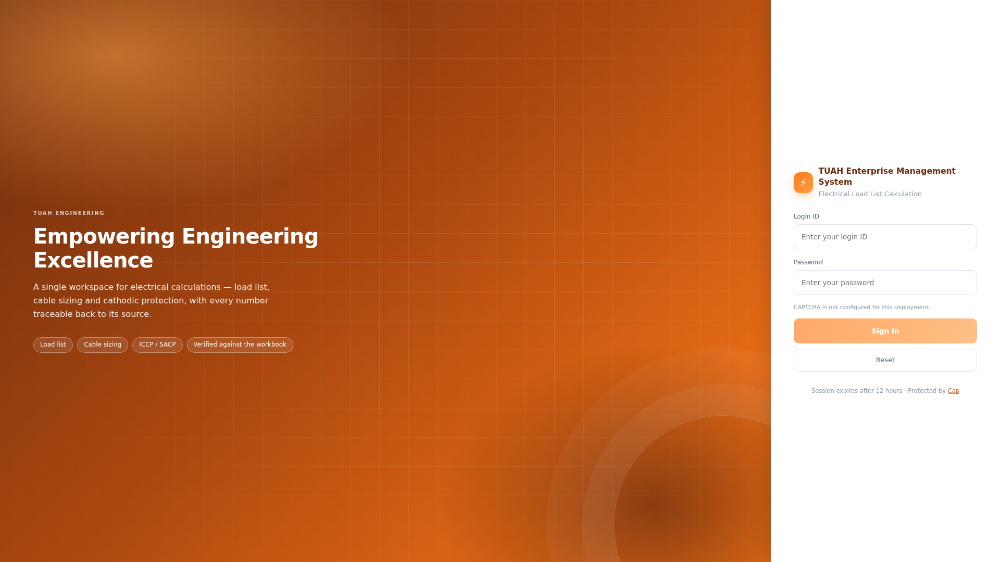
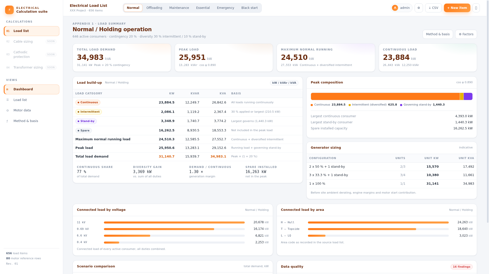
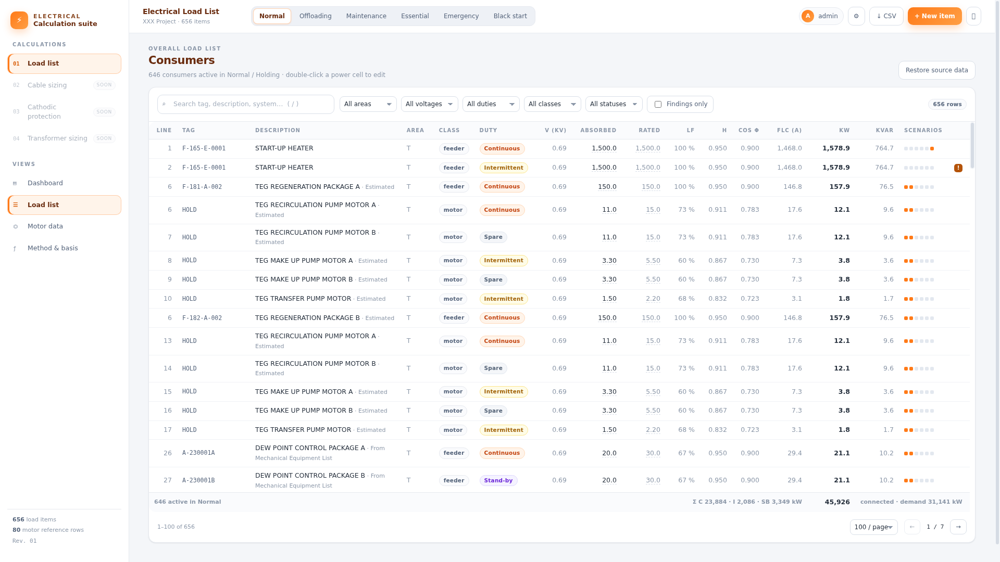

# Electrical Load List — calculation web app

[](https://github.com/ashcoft/electricacl/actions/workflows/ci.yml)
[](https://github.com/ashcoft/electricacl/actions/workflows/release.yml)
[](https://github.com/ashcoft/electricacl/releases)
[](https://github.com/ashcoft/electricacl/pkgs/container/electricacl)

A ready-to-run electrical load list calculator: a Rust calculation engine behind a REST API, and a
Vue 3 + Vite interface built for engineers who have to defend the numbers. Sign-in protected, with an
optional self-hosted [Cap](https://github.com/tiagozip/cap) CAPTCHA.

The engine reproduces the workbook calculation to the last decimal — continuous, intermittent,
stand-by and spare loads per operating scenario, motor efficiency and power factor interpolated from
the motor reference curve, maximum normal running load, peak load and total demand with spare
contingency.



## What it calculates

For every consumer:

```
load factor   = absorbed power / nameplate rating
efficiency    = interpolated from the motor curve at that load factor
power factor  = interpolated from the motor curve at that load factor
consumed kW   = absorbed power / efficiency
consumed kVAr = consumed kW × tan(acos(cos φ))
FLC           = rated kW / (√3 × kV × efficiency × cos φ)
```

Per scenario (normal/holding, offloading, maintenance, essential, emergency, black start):

```
maximum normal running = continuous + max(30 % × intermittent, largest intermittent)
peak load              = continuous + 30 % × intermittent + max(10 % × stand-by, largest stand-by)
total demand           = peak load × (1 + 20 % contingency)
```

The 30 / 10 / 20 % factors are configurable in the UI and stored with the project.

**Verification.** The integration tests (`backend/tests/workbook.rs`) assert the totals of the source
workbook within 1 × 10⁻⁶ kW:

| Scenario       | Total demand (kW) | Source             |
| -------------- | ----------------: | ------------------ |
| Normal/Holding |         31 140.75 | Summary table 1.0  |
| Maintenance    |          7 833.77 | Summary table 3.0  |
| Essential      |         11 614.19 | Summary table 4.0  |
| Emergency      |          1 929.79 | Recommendation 8.5 |



## Quick start

```bash
docker run --rm -p 8080:8080 -v loadlist-data:/app/data \
  -e AUTH_PASSWORD=choose-a-strong-password \
  ghcr.io/ashcoft/electricacl:latest
```

Open <http://localhost:8080> and sign in as `admin`.

If `AUTH_PASSWORD` is not set, the service generates one on first boot and prints it once:

```bash
docker logs <container> | grep "initial login"
# initial login: admin / 1f9c0b…      change it with AUTH_PASSWORD or: electricacl --reset-password
```

### Docker Compose

```bash
cp .env.example .env      # set AUTH_PASSWORD
docker compose up -d
```

With CAPTCHA:

```bash
docker compose --profile captcha up -d
```

Then open <http://localhost:3000>, sign in with `CAP_ADMIN_KEY`, create a site, and copy its **site
key** and **secret** into `.env`:

```dotenv
CAP_API_ENDPOINT=http://localhost:3000/<site-key>/
CAP_SECRET=<secret>
```

`docker compose up -d` again and the login form requires a solved challenge. The endpoint must be
reachable from the browser, so use your public URL in production (and `COOKIE_SECURE=true` behind
HTTPS).

## Configuration

| Variable            | Default    | Purpose                                                      |
| ------------------- | ---------- | ------------------------------------------------------------ |
| `PORT`              | `8080`     | HTTP port                                                    |
| `DATA_DIR`          | `./data`   | Load list state and credentials                              |
| `STATIC_DIR`        | `./static` | Frontend bundle served by the same process                   |
| `AUTH_USERNAME`     | `admin`    | Sign-in user name                                            |
| `AUTH_PASSWORD`     | generated  | Sign-in password (≥ 8 characters)                            |
| `COOKIE_SECURE`     | `false`    | Mark the session cookie `Secure` (enable behind HTTPS)        |
| `CAP_API_ENDPOINT`  | –          | Cap site endpoint, e.g. `https://cap.example.com/<site-key>/` |
| `CAP_SECRET`        | –          | Cap site secret; must be set together with the endpoint      |
| `RUST_LOG`          | `info`     | Log filter                                                   |

The binary also answers `--healthcheck` (used by the image `HEALTHCHECK`) and `--reset-password`
(regenerates the password and prints it).

## Authentication

- Passwords are stored as Argon2 hashes in `DATA_DIR/credentials.json` (mode `0600`); the password
  itself is never written to disk.
- Sessions are stateless: an HMAC-SHA256 signed cookie (`HttpOnly`, `SameSite=Lax`, 12 h expiry)
  signed with a random key stored beside the credentials.
- Five failed attempts from one address lock that address out for five minutes.
- Every API route except `/api/health` and `/api/auth/*` requires a valid session; the SPA shell is
  public so the login page can load.
- Cap is verified server-side against `<endpoint>/siteverify` with the site secret before a session
  is issued. Without `CAP_API_ENDPOINT`/`CAP_SECRET` the challenge is skipped and the login page says
  so.

## Interface

- **Dashboard** — KPI cards, load build-up per category, peak composition, generator sizing options,
  connected load by voltage level and area, scenario comparison, data-quality findings.
- **Load list** — 656 consumers, filter by area/voltage/duty/class/status, search, sort, page, inline
  edit of absorbed and rated power, CSV export.
- **Consumer detail** — live recalculation while you type, with the formula and the substituted
  numbers on screen, plus warnings for a missing duty, a missing scenario or a motor rating that is
  not in the reference table.
- **Motor data** — the 80-row efficiency / power factor reference table.
- **Method & basis** — the calculation chain and the workbook verification.



## Local development

Requirements: Rust stable, Node 22, Python 3 with `openpyxl` only if you want to re-extract the seed.

```bash
# terminal 1 - API (generates and prints a password on first run)
cd backend
cargo run                      # http://localhost:8080

# terminal 2 - Vite with /api proxy
cd frontend
npm install
npm run dev                    # http://localhost:5173
```

Build the bundle and let the Rust service serve it:

```bash
make build
cd backend && STATIC_DIR=../frontend/dist cargo run
```

Tests and checks:

```bash
make test     # cargo test + vue-tsc
make lint     # cargo clippy -D warnings
make fmt
```

## API

Public routes:

| Method | Path                | Description                          |
| ------ | ------------------- | ------------------------------------ |
| `GET`  | `/api/health`       | Liveness probe                       |
| `GET`  | `/api/auth/config`  | Session state and CAPTCHA settings   |
| `POST` | `/api/auth/login`   | `{username, password, cap_token}`    |
| `POST` | `/api/auth/logout`  | Clears the session cookie            |

Session required (cookie `eacl_session`):

| Method   | Path                             | Description                                 |
| -------- | -------------------------------- | ------------------------------------------- |
| `GET`    | `/api/state`                     | Items + derived values + all summaries      |
| `GET`    | `/api/summaries`                 | Scenario summaries only                     |
| `GET`    | `/api/motor-table`               | Motor reference curve                       |
| `GET`    | `/api/settings`                  | Contingency and diversity factors           |
| `PUT`    | `/api/settings`                  | Update the factors                          |
| `POST`   | `/api/load-items`                | Create a consumer                           |
| `PUT`    | `/api/load-items/{id}`           | Update a consumer                           |
| `DELETE` | `/api/load-items/{id}`           | Delete a consumer                           |
| `POST`   | `/api/load-items/{id}/duplicate` | Duplicate a consumer                        |
| `PUT`    | `/api/load-items`                | Replace the whole list (`{"items": [...]}`) |
| `POST`   | `/api/load-items/reset`          | Restore the embedded source data            |
| `GET`    | `/api/export/csv`                | CSV export including all derived values     |

Example:

```bash
curl -s -c /tmp/jar -X POST localhost:8080/api/auth/login \
  -H 'Content-Type: application/json' \
  -d '{"username":"admin","password":"choose-a-strong-password"}'
curl -s -b /tmp/jar localhost:8080/api/state | jq '.summaries[0].demand'
# { "kw": 31140.746828032006, "kvar": 15939.711911076838, "kva": 34983.128719189815 }
```

## Project layout

```
backend/            Rust service (axum)
  src/calc/         load list engine + motor curve
  src/auth.rs       sessions, Argon2 credentials, Cap verification
  src/models.rs     data model (items, duties, scenarios, settings)
  src/store.rs      persistence (JSON on disk, seed embedded in the binary)
  src/api.rs        REST handlers and the auth middleware
  data/seed.json    consumers + motor table extracted from the workbook
  tests/            workbook verification + HTTP auth tests
frontend/           Vue 3 + TypeScript + Vite
tools/              extract_seed.py - regenerate seed.json from LOAD LIST.xlsx
docker-compose.yml  app, plus Cap + Valkey under the `captcha` profile
Dockerfile          multi-stage build, unprivileged runtime
.releaserc.json     semantic-release configuration
.github/workflows   CI, Release (semantic-release + versioned image), Container image (snapshots)
```

Data flow: the seed is extracted once from `LOAD LIST.xlsx` (`make seed`) and embedded in the binary,
so the image is self-contained. At runtime the service copies it into `DATA_DIR` on first start and
persists every edit there.

## Releases

Versions, the changelog and the container tags are produced automatically by
[semantic-release](https://semantic-release.gitbook.io/) from
[Conventional Commits](https://www.conventionalcommits.org/). Nothing is versioned by hand.

| Commit message                          | Release |
| --------------------------------------- | ------- |
| `fix: correct stand-by diversity`        | patch   |
| `feat: add cable sizing screen`          | minor   |
| `feat!: change the calculation API`      | major   |
| `docs:`, `chore:`, `test:`, `refactor:`  | none    |

On every push to `main` the `Release` workflow analyses the commits, writes `CHANGELOG.md`, tags
`vX.Y.Z`, opens the GitHub release and publishes the matching image:

```bash
docker pull ghcr.io/ashcoft/electricacl:1.2.3   # exact release
docker pull ghcr.io/ashcoft/electricacl:1.2     # latest patch of 1.2
docker pull ghcr.io/ashcoft/electricacl:latest  # latest release
```

Every push also publishes a moving `sha-<short>` tag through the `Container image` workflow, so a
specific commit can be deployed before it is released.

The `@semantic-release/git` plugin commits `CHANGELOG.md` back to `main`. If `main` is protected,
allow the GitHub Actions bot to bypass the rule (or drop that plugin from `.releaserc.json`).

## Roadmap

The interface already reserves space for the next calculations in the suite:

1. **Load list** — this release.
2. Cable sizing (voltage drop, derating, short-circuit withstand).
3. Cathodic protection — ICCP and SACP for piping, pipelines and tanks.
4. Transformer and generator sizing.

## License

MIT.
